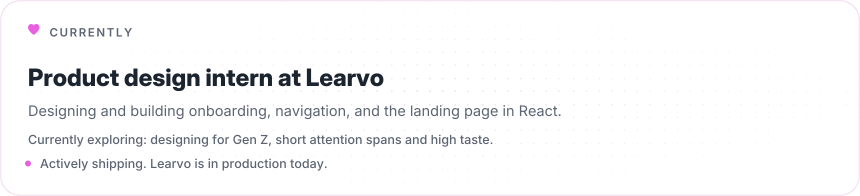
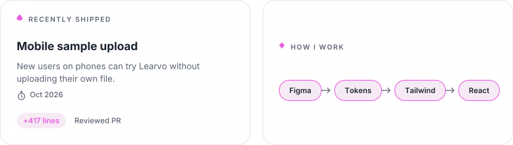
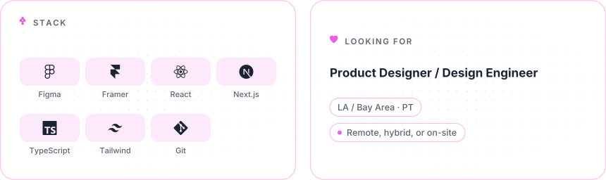

<picture>
  <source media="(prefers-color-scheme: dark)" srcset="assets/header-dark-v2.svg">
  <source media="(prefers-color-scheme: light)" srcset="assets/header-light-v2.svg">
  
</picture>

<p align="center">
  <a href="https://www.hannahroxas.com/"><picture><source media="(prefers-color-scheme: dark)" srcset="assets/btn-portfolio-dark.svg"></picture></a>
  <a href="https://www.hannahroxas.com/resume.pdf"><picture><source media="(prefers-color-scheme: dark)" srcset="assets/btn-resume-dark.svg"></picture></a>
  <a href="https://www.linkedin.com/in/hannah-roxas-1440ba299/"><picture><source media="(prefers-color-scheme: dark)" srcset="assets/btn-linkedin-dark.svg"></picture></a>
  <a href="mailto:hannahroxas0602@gmail.com"><picture><source media="(prefers-color-scheme: dark)" srcset="assets/btn-email-dark.svg"></picture></a>
</p>

<br>

<picture>
  <source media="(prefers-color-scheme: dark)" srcset="assets/bento-currently-dark.svg">
  <source media="(prefers-color-scheme: light)" srcset="assets/bento-currently-light.svg">
  
</picture>

<picture>
  <source media="(prefers-color-scheme: dark)" srcset="assets/bento-row2-dark.svg">
  <source media="(prefers-color-scheme: light)" srcset="assets/bento-row2-light.svg">
  
</picture>

<picture>
  <source media="(prefers-color-scheme: dark)" srcset="assets/bento-row3-dark.svg">
  <source media="(prefers-color-scheme: light)" srcset="assets/bento-row3-light.svg">
  
</picture>

Code to look at → [hannah-roxas-portfolio](https://github.com/hannahroxas0602-cyber/hannah-roxas-portfolio), the Next.js source behind every project above, including the components below.

<picture>
  <source media="(prefers-color-scheme: dark)" srcset="assets/divider-dark.svg">
  <source media="(prefers-color-scheme: light)" srcset="assets/divider-light.svg">
  
</picture>

### From design to code

A real hook from [hannahroxas.com](https://www.hannahroxas.com/), fixing a
bug where Next.js's hash scroll landed in the wrong spot while the hero
image above it was still loading and shifting the page height. It scrolls
once on mount, then again after a short delay to correct for that late
layout shift:

```tsx
"use client";

import { useEffect } from "react";

export function useScrollToHash() {
  useEffect(() => {
    const hash = window.location.hash;
    if (!hash) return;

    const scrollToTarget = () => {
      const el = document.getElementById(hash.slice(1));
      el?.scrollIntoView({ block: "start" });
    };

    scrollToTarget();
    const timeout = setTimeout(scrollToTarget, 400);
    return () => clearTimeout(timeout);
  }, []);
}
```

<p align="center"><sub><a href="https://www.hannahroxas.com">hannahroxas.com</a> · <a href="mailto:hannahroxas0602@gmail.com">hannahroxas0602@gmail.com</a></sub></p>
